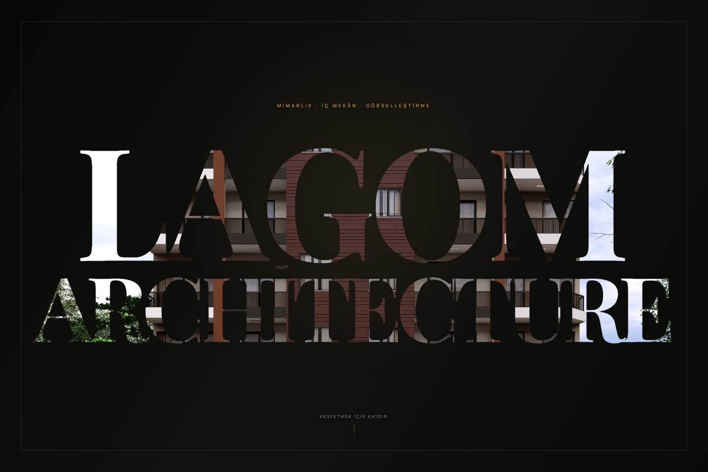
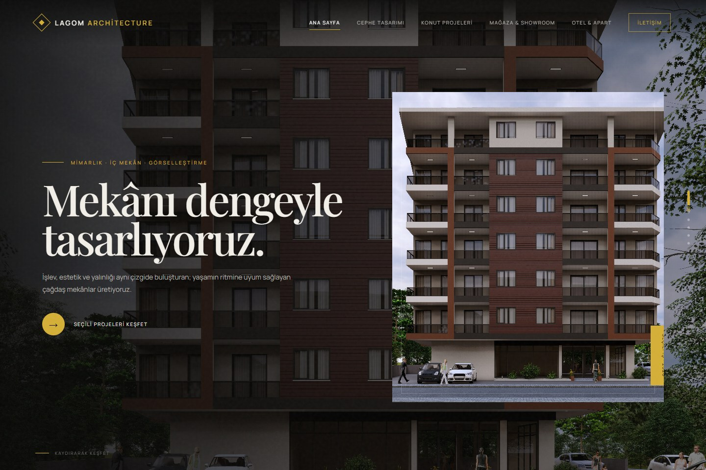
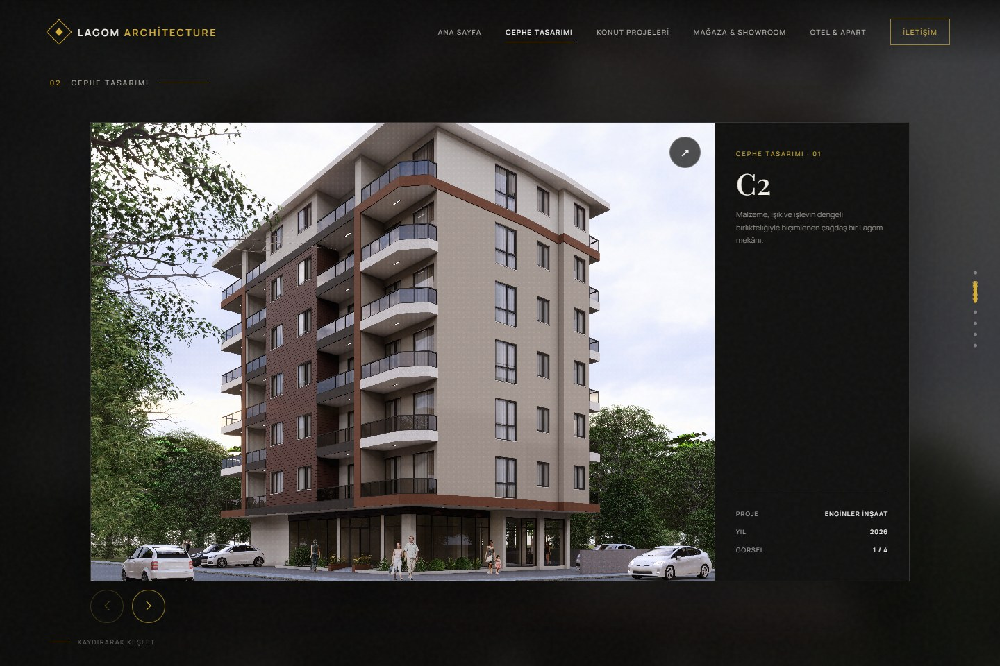
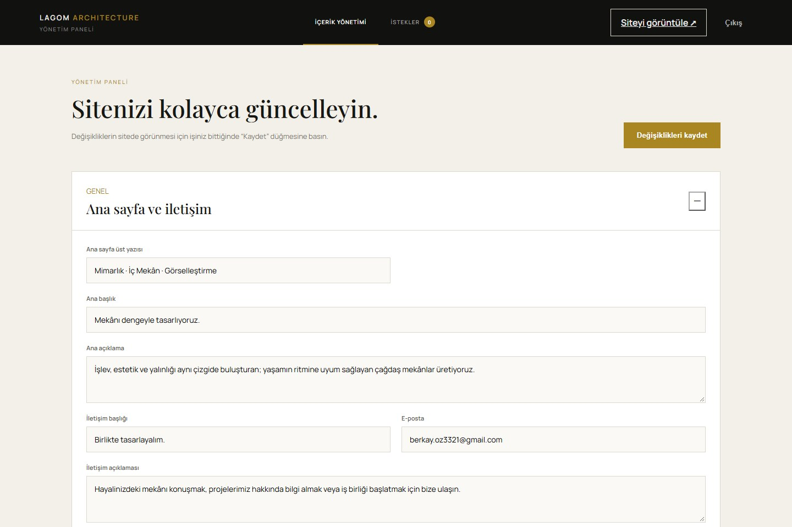
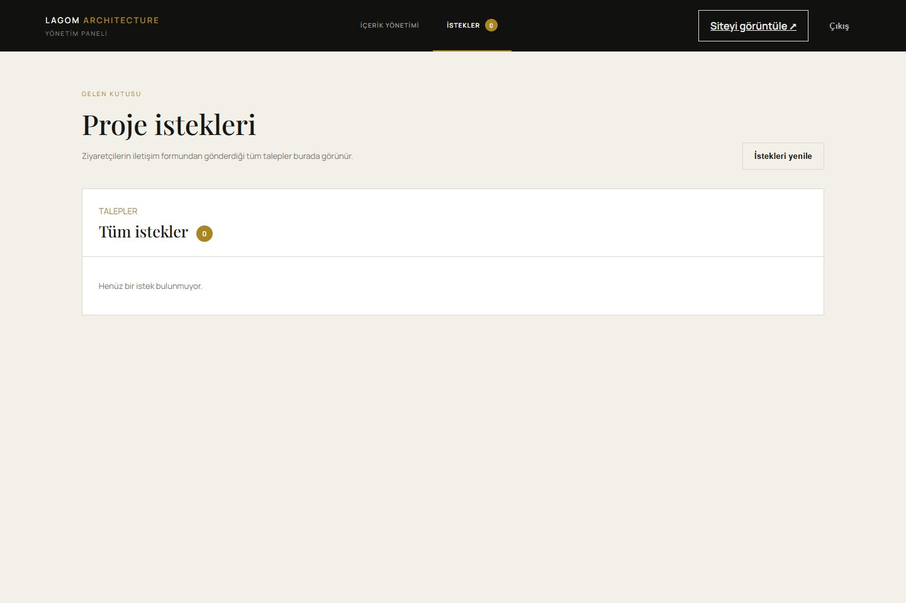
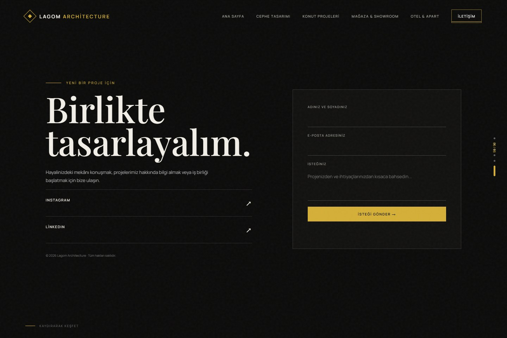

# LAGOM ARCHITECTURE

**Bir mimarlık şirketi için geliştirilen, yönetim panelli kurumsal portföy sitesi.**

Mimari projeleri, iç mekân tasarımlarını ve görselleştirme çalışmalarını güçlü bir görsel anlatımla sunmak için hazırlandı. Siyah–altın renk dili, geniş tipografi ve tam ekran proje galerileri; şirketin çalışmalarını merkeze alan bir deneyim oluşturuyor. İçerik yönetimi, yazılımcı desteği gerektirmeden proje ve fotoğraf ekleyebilmesi için şirket sahibine göre tasarlandı.



## Deneyim

Ziyaretçi, mimari görsellerin harflerin içinden göründüğü **LAGOM ARCHITECTURE** açılışıyla karşılanır. Tek bir aşağı kaydırma, yazının merkezine doğru ilerleyen yaklaşık dört saniyelik yakınlaşmayı başlatır ve ana sayfayı açar.

Ana sayfadan sonra dikey kaydırma proje bölümleri arasında, yatay kaydırma ise bölümdeki görseller arasında gezinmeyi sağlar. Proje kartlarında kategori, proje adı, açıklama, yıl ve görsel sayacı bulunur. Görseller büyütülerek incelenebilir. Son bölümdeki iletişim formu, ziyaretçinin isteğini yönetim paneline iletir.



## Proje galerisi

Cephe tasarımı, konut projeleri, mağaza/showroom ve otel/apart çalışmaları ayrı bölümler halinde sunulur. Bölümler ve içerik sırası yönetim panelinden değiştirilebilir.



## Yönetim paneli

Panel, günlük kullanımda iki ana alan sunar:

| Alan | Yapılabilen işlemler |
| --- | --- |
| **İçerik Yönetimi** | Bölüm ve proje ekleme/kaldırma, başlık ve açıklama düzenleme, yıl belirleme, fotoğraf yükleme, bölüm/proje/fotoğraf sıralama |
| **İstekler** | Gelen talepleri görüntüleme, okunma durumunu değiştirme, e-posta ile yanıt başlatma ve talep silme |

Yeni yüklenen görseller tarayıcıda %90 kalite ayarıyla WebP biçimine dönüştürülür; uzun kenar en fazla 2560 piksel olacak şekilde oran korunur. Ziyaretçi sitesindeki içerik kaydetme işlemiyle güncellenir. Her içerik kaydında bir önceki sürümün yedeği alınır.



<details>
<summary><strong>İstekler ekranını görüntüle</strong></summary>



</details>

## İletişim

Ad-soyad, e-posta ve mesaj alanlarından oluşan formun gönderimleri sunucuda saklanır. Form doğrulaması, gizli spam alanı ve saatlik gönderim sınırı bulunur. Mesajlar yalnızca yönetici oturumuyla API üzerinden okunabilir.



## Teknolojiler

| Katman | Kullanılan yapı |
| --- | --- |
| Arayüz | HTML5, CSS3 ve JavaScript |
| Galeri ve gezinme | Swiper 11; dikey bölümler ve yatay Creative geçişi |
| Sunucu | Node.js yerleşik HTTP modülü |
| İçerik | JSON dosyaları ve yerel dosya sistemi |
| Yönetici oturumu | Sunucu taraflı oturum ve HttpOnly çerez |
| Tipografi | Manrope ve Playfair Display |
| Kontroller | Node.js test çalıştırıcısı; ekran görüntüleri için isteğe bağlı Playwright |

Uygulamanın çalışması için ek npm paketi veya derleme adımı gerekmez. Swiper ve Google Fonts tarayıcıda CDN üzerinden yüklenir.

## Yerel çalıştırma

**Gereksinim:** Node.js 18 veya üzeri.

```sh
git clone https://github.com/berkayozdmr21/lagom-architecture.git
cd lagom-architecture
```

`.env.example` dosyasını `.env` adıyla kopyalayın ve yönetici bilgilerinizi doldurun:

```dotenv
ADMIN_USERNAME=your-admin-username
ADMIN_PASSWORD=your-strong-password
PORT=3000
```

```sh
npm start
```

| Sayfa | Yerel adres |
| --- | --- |
| Ziyaretçi sitesi | http://localhost:3000 |
| Yönetim paneli | http://localhost:3000/admin |

Detaylı panel kullanımı: [Yönetim paneli rehberi](YONETIM-PANELI.md).

## Dosya düzeni

```text
├── index.html                 # Ziyaretçi sitesi ve galeri
├── intro-transition.js        # Açılış yakınlaşma animasyonu
├── site-content.js            # Yönetilen içeriği yükleme
├── admin.html / admin.js      # Yönetim paneli
├── admin.css                  # Panel tasarımı
├── inquiries.css              # İstek listesi tasarımı
├── panel-tabs.css             # Yönetim menüsü
├── server.js                  # HTTP sunucusu, oturum ve API
├── data/content.json          # Portföy içeriği
├── uploads/                   # Portföy görselleri
├── docs/screenshots/          # README ekran görüntüleri
├── scripts/                   # Ekran görüntüsü yardımcısı
└── tests/                     # Açılış davranışı kontrolleri
```

`.env`, müşteri isteklerini içeren `data/inquiries.json`, içerik yedekleri ve eski kod kopyaları Git deposuna dahil edilmez. Yeni kurulumda boş istek dosyası otomatik oluşturulur. Ekran görüntülerinde gerçek müşteri talepleri kullanılmamıştır.

## Kontroller ve çalıştırma ortamı

```sh
node --test tests/intro-transition.test.cjs
```

Kontroller; tek kaydırmayla animasyonun başlamasını, tekrar kaydırmaların animasyonu yeniden başlatmamasını, dokunmatik hareketi ve azaltılmış hareket tercihini kapsar.

Yönetim paneli, yüklemeler ve talep kutusu Node.js sunucusu ile kalıcı dosya alanı gerektirir. GitHub deposu kaynak kodunu barındırır; depoya yüklemek siteyi otomatik olarak yayına almaz. GitHub Pages tek başına bu sunuculu özellikleri çalıştırmaz.
